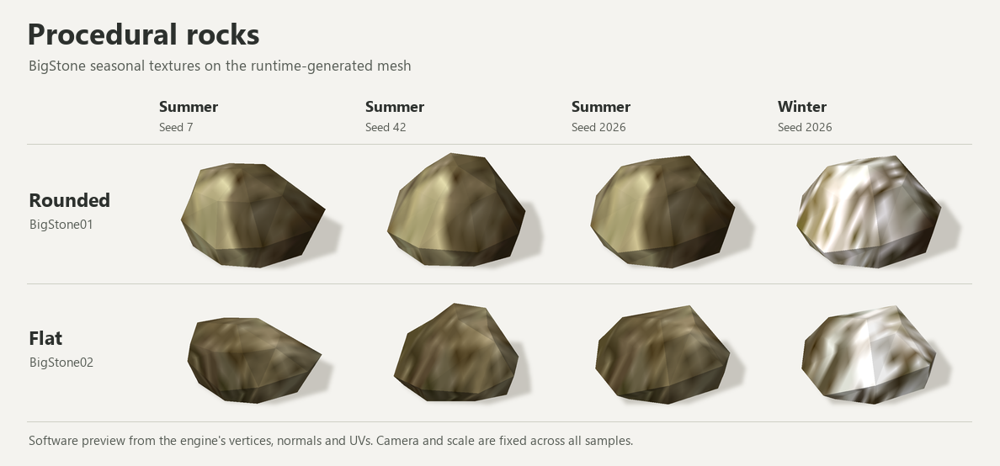

# Procedural rocks

## Compare four placements

The examples use the procedural recipe type from the current OpenBK2 database schema. If your editor uses a separate game-data installation, it needs the matching `types.xml` and the Rounded and Flat records. [Database schema](../../Versions/Current/Data/types.xml) · [Bundled rock records](../../Versions/Current/Data/Objects/SimpleObjects/ProceduralRocks)

Open a map with the current OpenBK2 Map Editor and game data. In the `ObjectRPGStats` tree, open `Objects/SimpleObjects/ProceduralRocks`. Place three **Rounded** rocks and one **Flat** rock in a row on level ground. Give them the same direction, then set each object's `ProceduralSeed` in its placement properties.

| Placement | Object | Seed | What to look for |
| --- | --- | ---: | --- |
| 1 | Rounded | 7 | Use this silhouette as the reference. |
| 2 | Rounded | 7 | The outline and facets match the first rock at a different position. |
| 3 | Rounded | 42 | Changing the seed gives the same recipe a different outline. |
| 4 | Flat | 42 | Keeping the seed and changing the recipe produces a lower rock. |

To use the same arrangement directly in map XML, append the four `<Item>` elements to your map's existing `<MapInfo><Objects>` list. Adjust their `<Pos>` values to put the row on clear ground near the starting camera. Save and reopen the map, or launch the mission, to see the same four shapes. [Map placement fragment](MapInfo.objects.fragment.xml)

The preview uses the engine's generated mesh data with the BigStone textures, rendered offline.

## Add the LowSlab example to a mod

1. Copy the [LowSlab folder](LowSlab) to `Objects/SimpleObjects/LowSlab/` under your mod's data root.
2. Open that mod in the Map Editor. Use **File > Register XDB** to register `Rock.xdb`, then `ObjectRPGStats.xdb`.
3. Select `Objects/SimpleObjects/LowSlab/ObjectRPGStats.xdb` in the `ObjectRPGStats` tree and place it next to a Flat rock. Set both seeds to `42` to compare the recipes.

LowSlab keeps Flat's nominal width and depth. It lowers the height from `0.88` to `0.60` scene units and raises `Roughness` from `0.75` to `0.90`. Edit `Size` and `Roughness` to change the whole family of rocks. Roughness ranges from `0` to `1`. [LowSlab recipe](LowSlab/Rock.xdb)

The placeable stats record links the recipe through `ProceduralRecipe`. Its `visualObject` supplies BigStone02's seasonal materials and picking hull. The passability profile in the stats defines the blocked ground, so adjusting the recipe changes the visible rock while preserving that footprint. [LowSlab object stats](LowSlab/ObjectRPGStats.xdb)
